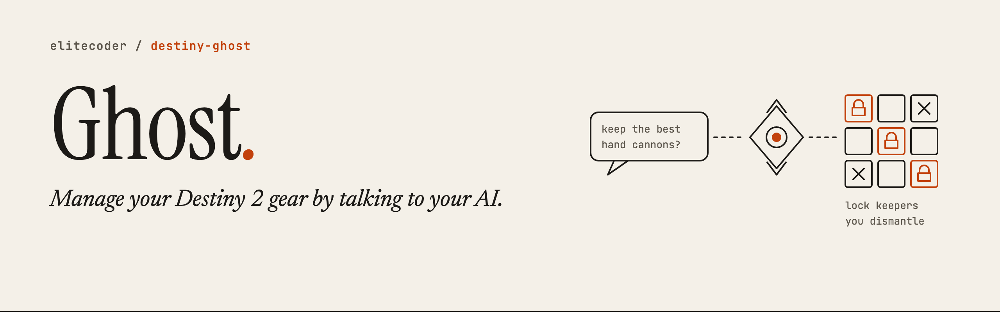
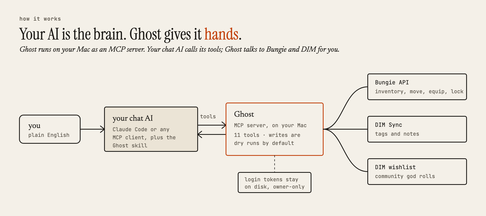
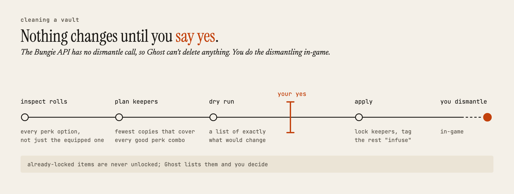

<picture>
  <source media="(prefers-color-scheme: dark)" srcset="docs/images/banner-dark.png">
  
</picture>

**An MCP server that lets your AI manage your Destiny 2 gear.**

Add Ghost to Claude Code, then ask which hand cannons are worth keeping, where your Fatebringer is, or whether your armor can hit a build. Ghost reads your inventory, grades your weapon rolls, and moves, equips, locks, and tags items for you. It does what [DIM](https://github.com/DestinyItemManager/DIM) and [Destiny Recipes](https://destinyrecipes.com) do, in a conversation.

You don't need an Anthropic API key. Your AI does the thinking, and Ghost gives it access to your gear.

Ghost comes in two pieces:

- **The MCP server** gives your AI 11 tools for your Destiny 2 account. This is Ghost.
- **The skill**, `SKILL.md`, is the playbook that comes with it. It teaches Claude Code to show you every change before making it and to compare duplicate weapons perk by perk.

## What you can ask

| You ask | Ghost uses |
|---|---|
| "What's my lowest-power slot?" | `get_character_state` |
| "Where's my Fatebringer?" | `search_inventory` |
| "Which of my hand cannons are god rolls for PvP?" | `score_items` |
| "I have four copies of this scout rifle. Which should I keep?" | `inspect_rolls`, then the keeper planner |
| "Can I hit 100 Weapons and 70 Health with the armor I have?" | `find_armor_set` |
| "Move Fatebringer to my Warlock and equip it." | `transfer_item`, `equip_item` |
| "Lock the keepers and tag the rest infuse." | `set_lock`, `set_tag` |
| "What have I tagged junk in DIM?" | `get_tags` |
| "Pull that exotic out of the postmaster." | `pull_postmaster` |

## How it works

<picture>
  <source media="(prefers-color-scheme: dark)" srcset="docs/images/how-it-works-dark.png">
  
</picture>

Inside the server:

- **The tools** (`src/mcp/server.ts`) are what your AI calls.
- **The Bungie client** (`src/bungie/`) handles the OAuth login, waits as long as the API asks between calls, caches the game's item database, and plans moves. Moving an item between characters takes more than one call, because it goes through the vault.
- **The planners** (`src/scoring/`) grade rolls against the DIM community wishlist, pick the fewest copies of a weapon that cover every good perk combination, and search all your armor for a set that hits your stat targets.

The skill adds what the tools can't know on their own: the current Armor 3.0 stat names, the perk-by-perk way to compare duplicates, and the safety rules below.

## Safety

<picture>
  <source media="(prefers-color-scheme: dark)" srcset="docs/images/vault-cleanup-dark.png">
  
</picture>

- **Ghost can't delete anything.** The Bungie API has no dismantle call. When you ask Ghost to clean your vault, it locks the keepers and tags the rest `infuse`, and you dismantle them in-game.
- **Every change starts as a preview.** Write tools default to `dry_run: true` and return a plan without changing anything. The skill tells your AI to show you the plan and wait for an explicit yes before it applies it.
- **Locked items stay locked.** If you locked an item yourself and the planner didn't pick it, Ghost lists it for you to decide on. It never unlocks it.
- **Your login stays on your Mac.** Bungie and DIM tokens live in `~/.destiny-ghost/`, readable only by you.

## Quick start

You need:

- Node.js 22 or later.
- Claude Code, or another app that supports MCP servers.
- A Bungie.net account, so you can register a developer app.

1. Clone the repository and install its dependencies. The skill expects the repository at `~/dev/destiny-ghost`.

   ```bash
   git clone https://github.com/elitecoder/destiny-ghost.git ~/dev/destiny-ghost
   cd ~/dev/destiny-ghost
   npm install
   ```

2. Register an app at [bungie.net/en/Application](https://www.bungie.net/en/Application) with these settings:

   - **OAuth client type:** Confidential
   - **Redirect URL:** `https://127.0.0.1:7777/callback`, exactly as written
   - **Scopes:** Read your Destiny 2 information, and Move or equip Destiny gear

3. Copy the example settings file, then paste in your app's API key, client ID, and client secret:

   ```bash
   cp .env.example .env
   ```

4. Sign in to Bungie once. This opens your browser and saves your tokens to `~/.destiny-ghost/`.

   ```bash
   npm run auth
   ```

   The sign-in page runs on a local HTTPS address. If you have [mkcert](https://github.com/FiloSottile/mkcert) installed, Ghost uses a certificate your browser trusts. Otherwise your browser warns you once about a self-signed certificate, which is expected.

5. Add Ghost to Claude Code:

   ```bash
   claude mcp add destiny-ghost -- npx tsx ~/dev/destiny-ghost/src/mcp/server.ts
   ```

6. Install the skill:

   ```bash
   mkdir -p ~/.claude/skills/destiny-ghost
   ln -s ~/dev/destiny-ghost/SKILL.md ~/.claude/skills/destiny-ghost/SKILL.md
   ```

Then ask: "Score my hand cannons for PvP," or "Clean my vault, and keep the PvE god rolls."

DIM tags work without extra setup. The first time you use a tag tool, Ghost exchanges your Bungie login for a DIM Sync token.

## Tools

| Tool | What it does | Changes your gear |
|---|---|---|
| `get_character_state` | Lists your characters, their power, vault space, and postmaster counts. | No |
| `search_inventory` | Finds items from a plain-English description, such as "void hand cannons in the vault." | No |
| `score_items` | Grades weapons S through F against the DIM community wishlist, for PvE or PvP. | No |
| `inspect_rolls` | Shows every selectable perk in each column, the basis for keeping or dismantling duplicates. | No |
| `get_tags` | Reads your DIM tags and notes. | No |
| `find_armor_set` | Searches all your armor for a five-piece set that hits your stat targets, or names the stat you need to farm. | No |
| `transfer_item` | Moves an item to the vault or another character. | Yes, preview first |
| `equip_item` | Equips an item. Works only in orbit, social spaces, or offline. | Yes, preview first |
| `set_lock` | Locks or unlocks an item. | Yes, preview first |
| `set_tag` | Sets or clears DIM tags on one or many items. | Yes, preview first |
| `pull_postmaster` | Moves an item from the postmaster to its character. | Yes, preview first |

## Vault report

`npm run vault-report` prints a summary of your whole account:

- Items by tier.
- Weapons you have five or more copies of.
- Armor counts by class and slot.
- Items tagged infuse, junk, or archive that are still locked.
- Armor sets with a piece tagged infuse, junk, or archive, so you can review them before you dismantle.

## Development

```bash
npm run typecheck   # check types
npm test            # run the 51 unit tests
npm run mcp         # start the MCP server on stdio
```

The planners take plain data, with no network calls, so the tests run offline.

## Limits

- Roll grades come from a community wishlist and are advice, not fact. The game has no PvP flag, so "best for PvP" means the wishlist's PvP ranking.
- Lock and tag changes can take a moment to show in the game and in DIM.
- Bungie doesn't publish most of its rate limits. Ghost waits as long as each response asks.
- Read Bungie's API terms before you share your app with other players.
